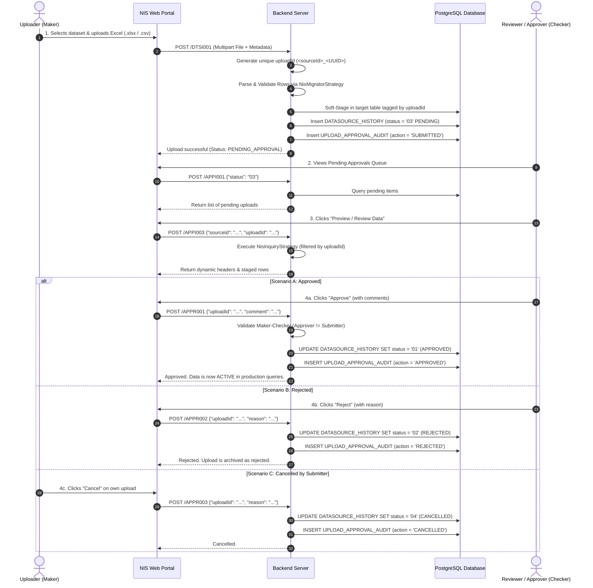

# NIS Web Portal - Upload & Approval Workflow Guide

---

## 1. System Overview & Lifecycle Diagram



---

## 2. User & Business Guide

### Who is this for?
- **Data Entry Officers / Data Owners (Makers)**: Users responsible for uploading Excel spreadsheets.
- **Supervisors / Managers / Admins (Checkers)**: Authorized users who review and approve or reject uploaded datasets.

---

### Key Concepts

| Concept | Explanation |
| :--- | :--- |
| **Pending Approval (`03`)** | When an Excel file is uploaded, the data is saved in a staging state. It is **not yet visible** in public/production reporting dashboards. |
| **Maker-Checker Rule (Four-Eyes Principle)** | A strict governance rule: **The user who uploaded a file cannot approve their own submission**. A separate supervisor or administrator must review it. |
| **Data Preview** | Reviewers can inspect the full table layout, columns, numbers, and Khmer/English headers before making an approval decision. |
| **Audit Trail** | Every action (who submitted, who approved/rejected, date, time, and comments) is permanently logged. |

---

### User Step-by-Step Walkthrough

#### Step 1: Uploading an Excel File (Data Submitter)
1. Navigate to **Data Management $\rightarrow$ Upload Data**.
2. Select the target **Dataset Category** (e.g., *Economic Statistics, Census, National Accounts*).
3. Choose the Excel file (`.xlsx` or `.csv`) from your computer.
4. Enter a meaningful **Description / Notes** (e.g., *"Q3 2026 Monthly Census Revision"*).
5. Click **Submit**.
6. The system validates the columns and format. Once accepted, the status shows **Pending Approval (`03`)**.

#### Step 2: Reviewing Pending Uploads (Reviewer / Approver)
1. Navigate to **Approval Management $\rightarrow$ Pending Requests**.
2. You will see a list of submissions waiting for review, showing:
   - Dataset Name & Category
   - Submitter Name & Submission Timestamp
   - Total row counts and description
3. Click the **Review / Preview** button on any item.
4. The system loads the **Staged Data Preview Grid**, allowing you to inspect rows, verify calculations, and check formatting before approving.

#### Step 3: Making a Decision
- **To Approve**:
  - Click **Approve**.
  - Enter optional approval notes.
  - The dataset status transitions to **Approved (`01`)**. It immediately becomes available in standard reports and inquiry screens.
- **To Reject**:
  - Click **Reject**.
  - Enter a **mandatory reason for rejection** (e.g., *"Column D has negative values; please revise"*).
  - The submitter will be notified, and status transitions to **Rejected (`02`)**.
- **To Cancel (Submitter only)**:
  - If you submitted a file with a mistake before it is reviewed, you can click **Cancel Request**. The status becomes **Cancelled (`04`)**.

---

## 3. Developer & Technical Guide

### Architecture: Soft-Staging Strategy
Instead of maintaining duplicate temporary tables for dozens of distinct dynamic datasets, the portal utilizes **Soft-Staging via `upload_id` tagging**:
1. Every upload is assigned a unique identifier: `<sourceId>_<UUID>` (e.g., `nis_05a1_7b6f3c1d-6a5e-4c7b-b0b1-382a869818a7`).
2. Migrator strategies (`NisMigratorStrategy`) parse and insert records with the specific `upload_id`.
3. The dataset registry (`datasource_history`) records the upload with `status = '03'` (**Pending Approval**).
4. Production inquiry queries filter by `status = '01'` (**Approved**). Thus, pending or rejected data never leaks into production views.

---

### Status Codes Reference

```
  [03] PENDING_APPROVAL  ---(Approve / APPR001)--->  [01] APPROVED (Active)
          |
          +----------------(Reject  / APPR002)--->  [02] REJECTED
          |
          +----------------(Cancel  / APPR003)--->  [04] CANCELLED
```

| Status Code | Enum Name | Description |
| :--- | :--- | :--- |
| `'03'` | `PENDING_APPROVAL` | Initial state upon file upload. Staged and waiting for review. |
| `'01'` | `APPROVED` | Verified by approver. Active and queryable in all public modules. |
| `'02'` | `REJECTED` | Declined by reviewer with audit reason recorded. |
| `'04'` | `CANCELLED` | Revoked by the original uploader before approval. |

---

### Key Backend Components

| Layer | Class | File Location | Responsibility |
| :--- | :--- | :--- | :--- |
| **Controller** | `ApprovalCbc` | `app/approval/ApprovalCbc.kt` | Exposes REST endpoints (`/APPI001`-`004`, `/APPR001`-`003`) with `@RequirePermission`. |
| **Service** | `ApprovalSbc` | `app/approval/ApprovalSbc.kt` | Executes Maker-Checker validation, status updates, dynamic preview delegation, and audit logging. |
| **Repository** | `ApprovalEbc` | `app/approval/ApprovalEbc.kt` | MyBatis DAO for `datasource_history` and `upload_approval_audit`. |
| **Mapper** | `ApprovalEbc.xml` | `resources/mappers/approval/ApprovalEbc.xml` | SQL queries with pagination, search, status updates, and audit trail inserts. |
| **Inquiry Strategy** | `NisInquiryStrategy` | `core/strategy/NisMigratorStrategy.kt` | Dynamically produces table headers and paginated rows filtered by `upload_id`. |
| **Migrator Strategy** | `NisMigratorStrategy` | `core/strategy/NisMigratorStrategy.kt` | Parses Excel/CSV into target PostgreSQL dataset tables tagged with `upload_id`. |

---

### Database Tables

#### 1. `datasource_history`
Tracks dataset metadata, current lifecycle status, and file paths.
- `history_id`: Primary Key
- `source_id`: Dataset identifier (e.g. `nis_05a1`)
- `upload_id`: `<sourceId>_<UUID>`
- `upload_file_name`: Display file name
- `status`: `'03'` (Pending), `'01'` (Approved), `'02'` (Rejected), `'04'` (Cancelled)
- `first_register_user`: Submitter user ID
- `archived_at`: Submission timestamp

#### 2. `upload_approval_audit`
Append-only audit trail table tracking every lifecycle event.
- `audit_id`: BigSerial Primary Key
- `upload_id`: Tagged upload ID
- `source_id`: Dataset ID
- `action`: `SUBMITTED`, `APPROVED`, `REJECTED`, `CANCELLED`
- `action_by`: Username of the actor
- `previous_status` $\rightarrow$ `new_status`
- `reason`: Notes, approval comments, or mandatory rejection reason
- `created_at`: Exact timestamp

---

### API Specification Summary

Base URL: `http://localhost:8010/api/nis-portal`

#### 1. List Approvals (`POST /APPI001`)
- **Body**:
  ```json
  {
    "status": "03",
    "sourceId": "",
    "search": "",
    "page": 1,
    "size": 10
  }
  ```

#### 2. Get Approval Details (`POST /APPI002`)
- **Body**:
  ```json
  {
    "uploadId": "nis_05a1_7b6f3c1d-6a5e-4c7b-b0b1-382a869818a7"
  }
  ```

#### 3. Preview Staged Data (`POST /APPI003`)
- **Body**:
  ```json
  {
    "sourceId": "nis_05a1",
    "uploadId": "nis_05a1_7b6f3c1d-6a5e-4c7b-b0b1-382a869818a7",
    "page": 1,
    "size": 50
  }
  ```
- **Returns**: Dynamic `header` list, `list` (paged rows), `total`, `totalPages`.

#### 4. Approve Upload (`POST /APPR001`)
- **Body**:
  ```json
  {
    "uploadId": "nis_05a1_7b6f3c1d-6a5e-4c7b-b0b1-382a869818a7",
    "comment": "Data verified against official survey."
  }
  ```

#### 5. Reject Upload (`POST /APPR002`)
- **Body**:
  ```json
  {
    "uploadId": "nis_05a1_7b6f3c1d-6a5e-4c7b-b0b1-382a869818a7",
    "reason": "Missing Q3 tax summary totals."
  }
  ```

#### 6. Cancel Upload (`POST /APPR003`)
- **Body**:
  ```json
  {
    "uploadId": "nis_05a1_7b6f3c1d-6a5e-4c7b-b0b1-382a869818a7",
    "reason": "Uploaded obsolete spreadsheet version."
  }
  ```

#### 7. Audit History Trail (`POST /APPI004`)
- **Body**:
  ```json
  {
    "uploadId": "nis_05a1_7b6f3c1d-6a5e-4c7b-b0b1-382a869818a7"
  }
  ```
